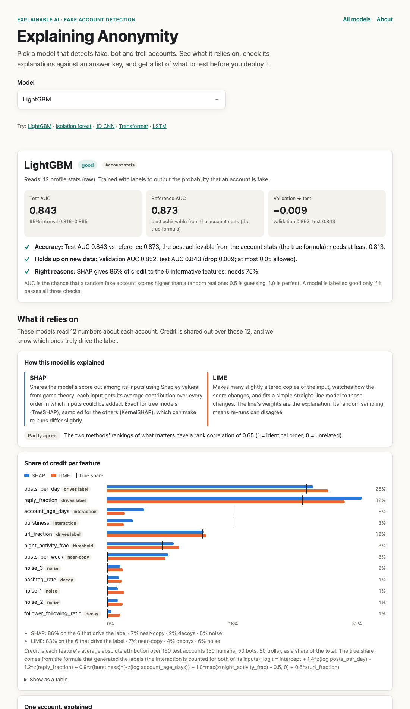

# Explaining Anonymity

**Live site: https://ananyafied.github.io/Explaining_Anonymity_Website/**

An interactive guide for developers deciding whether to deploy a model that detects fake, bot and
troll accounts. Pick one of 18 models and the site shows what it relies on, whether its
explanations point at the real signal, how it holds up when the fakes start hiding, and what to
test before it goes live.

Final project for Dr Brinnae Bent's class on Explainable AI (XAI) at Duke University. Builds on
[Explaining_Anonymity](https://github.com/ananyafied/Explaining_Anonymity).



## How it works

1. **Synthetic data with an answer key** (`anonsynth/`). 5,000 accounts whose bots and trolls are
   planted with known signals, so every explanation can be scored as right or wrong.
   [How the data is generated](docs/synthetic_data.md).
2. **Models** (`outputs/step1_fit/`). 28 detectors were trained. The fitting notebook is not
   included; the network definitions it used are in `xai_eval/step1_models.py`.
3. **Explanations** (`notebooks/02`–`07`, `xai_eval/`, `outputs/step2_explain/`). Each model was
   explained with the two methods most common for its type, and the explanations were scored on
   correctness, faithfulness, agreement and stability. [The plan](docs/step2_plan.md).
4. **Adversarial dataset** (`adversarial/`, `outputs/step3_adversarial/`). A fresh population whose
   bots and trolls disguise their account stats, hourly activity or posts, at mild and strong
   strength. Written up in three parts: [how the dataset was built](docs/adversarial_dataset.md),
   [the attacks](docs/adversarial_attacks.md) and [the results by model](docs/adversarial_results.md).
5. **Website** (`site/`). Static HTML, CSS and JavaScript on GitHub Pages, reading JSON that Python
   in `site/build/` generates from the results above. Verdicts, strengths, weaknesses and checklists
   come from fixed rules: [how models are labelled](docs/site_rules.md).

The site shows the **18 models that were attacked**: 11 that read account stats, 4 that read
hourly activity and 3 that read post text. The graph and multimodal models were trained and
explained but never attacked, so they are not on the site. Belief propagation (inverted scores) and
SVD + logistic regression (identical to PCA + logistic regression) were dropped earlier.

## Repository layout

| Folder | What it holds |
|---|---|
| `anonsynth/` | Synthetic data generator (`python -m anonsynth`) |
| `xai_eval/` | Model loaders and explanation metrics shared by the notebooks and scripts |
| `notebooks/` | Step 2 explainability notebooks (outputs cleared) |
| `adversarial/` | Adversarial data generator and evaluation scripts |
| `outputs/` | Saved results: `step1_fit/` (models), `step2_explain/`, `step3_adversarial/` |
| `site/` | The website: `public/` is served, `build/` generates its data |
| `docs/` | Write-ups and the labelling rules |
| `tests/` | Tests for the generators, the metrics and the site's rules |

## Rebuilding everything

```bash
pip install -r requirements-site.txt      # pinned versions that reproduce the saved models

# 1. data
python -m anonsynth --n-accounts 5000 --seed 0 --out data/synthetic
python -m adversarial                      # adversarial population, ~10 seconds

# 2. checks
python -m pytest                           # 66 tests
python site/build/verify_models.py         # every model reproduces its saved predictions

# 3. adversarial results (only needed if the attacks change)
python -m adversarial.evaluate_tabular     # ~10 minutes
python -m adversarial.evaluate_sequences   # ~2 minutes
python -m adversarial.evaluate_text        # ~5 minutes

# 4. the website's data (seconds; no models are loaded)
python site/build/build_models.py
python -m http.server -d site/public 8000  # preview at http://localhost:8000
```

Pushing changes under `site/public/` to `main` deploys the site
(`.github/workflows/pages.yml`). Generated data (`data/`, `adversarial/data/`) is not committed: it
is rebuilt exactly from the seeds.

To re-run the step 2 notebooks, install `requirements-xai.txt` and run notebooks 02 to 07 in order.
Each has a `QUICK = True` switch for a few-minute smoke test (its numbers are not meaningful).

## Known issue in the step 2 data

The step 2 notebooks stored LIME weights for the account-stat models (and for node2vec and
DeepWalk) with the **wrong sign**. The sizes are right and none of the step 2 scores are affected;
the site corrects the sign where it shows direction.
[Details](docs/site_rules.md#6-known-issue-in-the-step-2-data-lime-signs-account-stats).
